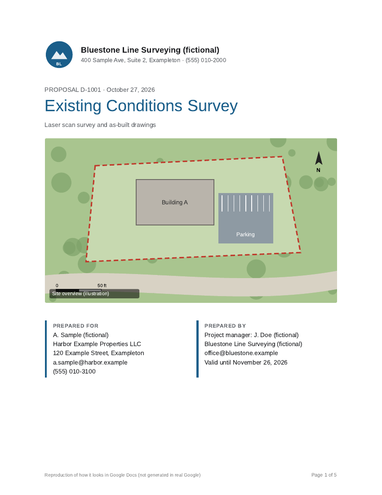
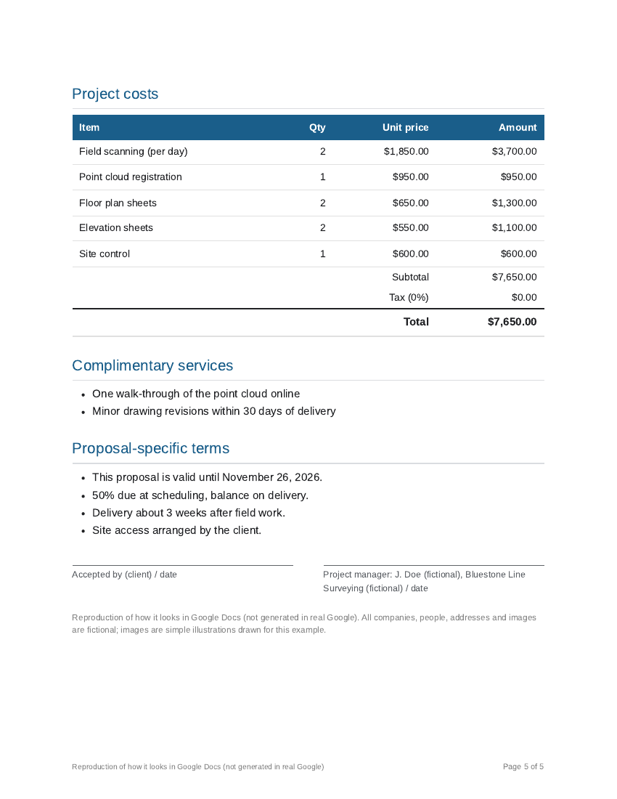

# Google Docs proposals from CRM rows (Apps Script sample)



Replaces copying each deal into a proposal by hand with one sheet row that fills 13 fields into a 5-page proposal Doc and PDF.

For a land-survey firm's sales staff: instead of copying each deal from the CRM sheet into a proposal by hand, the script builds the five-page proposal Doc and its PDF from that sheet row.



Tests: 32 of 32 pass with `npm test`.

## Template Doc
[Make a copy of the template Doc](https://docs.google.com/document/d/1EOYhbxU17O6odZ4I0zbC8TstZzIurqL5l8Znvx_WsAc/copy) (Google Docs asks you to save your own copy). It holds every tag in the table below in place of the values. Replace "Your Survey Company" with your company name, then put your copy's Doc ID in `CONFIG.TEMPLATE_ID` in `src/Code.gs`.

## Template tags and the 13 fields in the posting
| # | Field in the posting | Template tag(s) | Example |
|---|---|---|---|
| 1 | Cover page contact details | `{{ClientName}}` `{{ContactName}}` `{{ContactEmail}}` `{{ContactPhone}}` `{{Address}}` | [page 1](examples/proposal_bluestone-1.png) |
| 2 | Scope of work | `{{ScopeOfWork}}` | [page 2](examples/proposal_bluestone-2.png) |
| 3 | Areas to be surveyed (bulleted list and images) | `{{List:SurveyAreas}}` `{{Image:SurveyImages}}` | [page 2](examples/proposal_bluestone-2.png) |
| 4 | Equipment | `{{List:Equipment}}` | [page 2](examples/proposal_bluestone-2.png) |
| 5 | Site Photos | `{{Image:SitePhotos}}` | [page 3](examples/proposal_bluestone-3.png) |
| 6 | Deliverables list | `{{List:Deliverables}}` | [page 3](examples/proposal_bluestone-3.png) |
| 7 | Plan sheets included | `{{List:PlanSheets}}` | [page 3](examples/proposal_bluestone-3.png) |
| 8 | Deliverable example images | `{{Image:DeliverableImages}}` | [page 4](examples/proposal_bluestone-4.png) |
| 9 | Plan Sheet Details included/excluded lists | `{{List:Included}}` `{{List:Excluded}}` | [page 4](examples/proposal_bluestone-4.png) |
| 10 | Checkbox options for orthogonal and True geometry | `{{Check:Orthogonal}}` `{{Check:TrueGeometry}}` | [page 4](examples/proposal_bluestone-4.png) |
| 11 | Project Costs | `{{LineItems}}` `{{Subtotal}}` `{{Tax}}` `{{Total}}` | [page 5](examples/proposal_bluestone-5.png) |
| 12 | Complimentary Services | `{{List:ComplimentaryServices}}` | [page 5](examples/proposal_bluestone-5.png) |
| 13 | Proposal-specific terms | `{{Terms}}` or `{{List:Terms}}` | [page 5](examples/proposal_bluestone-5.png) |

Example output for two fictional survey firms: [Bluestone PDF](examples/proposal_bluestone.pdf) (pages [1](examples/proposal_bluestone-1.png) [2](examples/proposal_bluestone-2.png) [3](examples/proposal_bluestone-3.png) [4](examples/proposal_bluestone-4.png) [5](examples/proposal_bluestone-5.png)), [Meadowfield PDF](examples/proposal_meadowfield.pdf) (pages [1](examples/proposal_meadowfield-1.png) [2](examples/proposal_meadowfield-2.png) [3](examples/proposal_meadowfield-3.png) [4](examples/proposal_meadowfield-4.png) [5](examples/proposal_meadowfield-5.png)).

These pages are a reproduction of how it looks in Google Docs. They were laid out in HTML/CSS and printed to PDF by `examples/build.py`. The client's attached example PDF has not been seen, so this layout is not a copy of it. The layout will be rebuilt to match the example the client provides, with their graphics in the sizes and places they give.

## How it works
Each deal row in a Google Sheet becomes a proposal made from one Google Docs template. The script fills text tags, bullet lists, images from Drive, ☑/☐ checkboxes and a priced line-item table, saves a PDF in a Drive folder, and writes the Doc link, PDF link and status back to the row. Rerunning a row updates the same Doc. Rows with missing fields are skipped with a reason. An optional Gmail draft is off by default and mail is never sent.

## Overview
It reads deal rows (sheet rows) exported from CRM one by one and creates proposals from a single Google Docs template. It inserts text, bullet lists, Drive images, ☑/☐ checkboxes, and a price table, saves the PDF to a Drive folder, and writes the URL and status back to the row.

## How it works
1. Read rows in the `Deals` sheet from top to bottom
2. Check required fields and line items. If anything is missing, write `Skipped` and the reason, then continue
3. Copy the template for working use and fill in tags
4. Create a PDF from the working document
5. Change existing files only after both the new document and PDF are ready
   - If there is a previous `DocUrl`, clear that document body and copy in the working content (keep the same URL). Move the working copy to trash
   - Save a new PDF first, then move the old PDF to trash (if configured to use Advanced Drive, replace the content in the same file)
6. If it fails partway through, move only the working copy to trash and keep the old document and PDF as is. Mark the row as `Error` with a reason
7. Write `DocUrl` `PdfUrl` `Status` `Note` `UpdatedAt` back to the row

## Sheet columns
**Deals** (row 1 is headers)

| Column | Required | Content |
|---|---|---|
| DealId | Yes | Deal ID. Duplicate rows from the second duplicate onward are `Skipped` |
| ClientName | Yes | Recipient company name |
| ServiceType | Yes | Service name |
| ContactName, ContactEmail, ContactPhone, Address | | Contact details on the cover page |
| ScopeOfWork, Terms | | Text |
| SurveyAreas, Equipment, Deliverables, PlanSheets, Included, Excluded, ComplimentaryServices | | Bullet list items. Split by newline or `;` |
| SurveyImages, SitePhotos, DeliverableImages | | Drive file IDs or URLs. Split by newline or `;` |
| Orthogonal, TrueGeometry | | If yes / true / x / 1 then ☑, otherwise ☐ |
| ValidUntil | | Date (yyyy-MM-dd in the script time zone) |
| DocUrl, PdfUrl, Status, Note, UpdatedAt | | Written by the script. Header names are added if missing |

You can add any column names freely. The names above are examples matched to the 13 items in the first table.

**LineItems**: `DealId, Item, Qty, UnitPrice` (Qty is a number greater than 0, UnitPrice is 0 or more)

**Log** (optional): add one row per run with `DateTime, CreatedCount, SkippedCount, ErrorCount`.

## Merge tags
| Tag | Content |
|---|---|
| `{{ColumnName}}` | Text from the `Deals` column with the same name |
| `{{List:ColumnName}}` | Convert that column into a bullet list. If the value is empty, remove the whole tag line |
| `{{Image:ColumnName}}` | Insert Drive images from that column in order. Width is reduced to `IMAGE_WIDTH` (450pt) |
| `{{Check:ColumnName}}` | ☑ or ☐ |
| `{{Subtotal}}` `{{Tax}}` `{{Total}}` | Calculated from line items (example: `$699.50`) |
| `{{Today}}` | Creation date (script time zone) |
| `{{LineItems}}` | Line item table (Item / Qty / Unit price / Amount) |

How to place bullet list, image, and table tags:
- If it is a paragraph with only the tag (or one bullet line), replace that paragraph
- If there is other text in the same paragraph, remove only the tag text and insert content right after that paragraph
- If it is inside a table cell, insert content right after that table
- If `{{LineItems}}` is not in the template, add the table at the end and write `No {{LineItems}} tag, added at the end` in Note

## Setup steps
1. Create `Deals` `LineItems` `Log` in the sheet (you can import CSVs from `sample_data/`. Replace `PUT_DRIVE_FILE_ID_*` with your own image IDs)
2. Create a Docs template with the tags above and keep its ID
3. Create an output Drive folder and keep its ID
4. Paste `src/Code.gs` into Extensions > Apps Script
5. Update `TEMPLATE_ID` `FOLDER_ID` `TAX_RATE` `CURRENCY` `IMAGE_WIDTH` in `CONFIG`
6. If you want to keep the same PDF URL even after regeneration, add the Drive API service (Advanced Drive) and set `USE_ADVANCED_DRIVE: true`
7. If you need a draft, set `CREATE_DRAFT: true` (the job posting text does not mention email, so it is off by default)
8. Check the project time zone in settings (dates are read in this time zone)
9. Reopen the sheet and run menu "Proposals > Generate proposals". On first run, permission confirmation appears

## Out of scope and limitations
- It does not send email. Even with `CREATE_DRAFT`, it only creates a Gmail draft
- It does not connect to the CRM API (assumes CSV is pasted into the sheet)
- There is one template
- Regeneration rewrites the Docs body, so manual edits made in Docs are removed
- The document URL stays the same after regeneration. The PDF URL changes on each regeneration when `USE_ADVANCED_DRIVE` is off (old PDFs are moved to trash)
- Images are placed inline. Visual style and image positions will be rebuilt to match the sample received from the client (the sample PDF has not been seen yet)
- Rewriting the document body copies paragraphs, bullet lists, and tables. Header and footer from the template remain only in the working copy, so do not place tags in headers
- If it stops while copying a document, the old document can end up with partial content (PDF is new). The row becomes `Error`, so run it again
- If the rows would exceed the time limit for one run (6 minutes), process them in separate runs

## Tests
```
npm test
```
Requires Node 18+. Run node --test test/*.test.js (32 of 32 tests pass).

Note: built and tested with fictional data and local mocks; example output was rendered by `examples/build.py`; not yet run in a real Google Sheets or Apps Script project.
